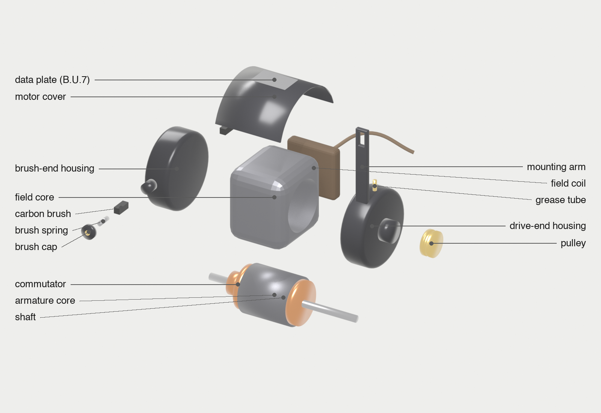

# BU7 motor model

A parametric Blender model of the Singer BU7 belt motor from the Singer 66, for
exploded views while Kristen repairs it. **It is a proportional sketch, not
CAD.** Every size comes from [bu7_dimensions.json](bu7_dimensions.json), and
all of them are camera estimates until marked `"measured": true`.



| File | What it is |
|---|---|
| [build_bu7.py](build_bu7.py) | builds the model and renders; run headless with Blender |
| [bu7_dimensions.json](bu7_dimensions.json) | every size, in inches, with a note of what it measures |
| [annotate.py](annotate.py) | draws callout labels on an exploded render |
| `bu7.blend` | the saved scene, to open and orbit in Blender |
| `renders/` | `bu7_assembled.png`, `bu7_exploded.png`, `bu7_exploded_labeled.png` |

## Re-render

From this folder:

```bash
/Applications/Blender.app/Contents/MacOS/Blender -b -P build_bu7.py -- --explode 1.0 --out renders/bu7_exploded.png --blend bu7.blend
/Applications/Blender.app/Contents/MacOS/Blender -b -P build_bu7.py -- --explode 0 --out renders/bu7_assembled.png
uv run annotate.py renders/bu7_exploded.png
```

`--explode` scales how far parts fly apart (0 = assembled). Each part's
direction is set where it is created in `build_bu7.py` (the `offset` passed to
`add()`). Renders take about 10 seconds each with EEVEE.

## Keeping it a twin

When something real is learned, update the model in the same session:

1. **A measurement:** put it in `bu7_dimensions.json` and set `"measured": true`.
2. **A part that looks different:** change its geometry in `build_bu7.py`
   and note the observation in [../motor.md](../motor.md).
3. Re-render, look at the images, and check every label points at its part.

## Known gaps versus the real motor

- **Internal wiring isn't modeled.** Where the two leads join (field coil vs.
  brush side) is still to be traced. Add it once it's seen.
- The field coil is a single slab on one side, matching what the camera showed.
  The real coil shape and whether there's a second coil aren't confirmed.
- The real mounting arm curves over the body. The model's is straight.
- The cover is modeled as a half-cylinder. The real one is a curved sheet whose
  exact wrap is unknown.
- Brush tubes are placed front and back on the brush end, from the two caps
  seen on camera.

## Build notes for agents

- Boolean cuts leave an empty material slot. `add()` clears slots and
  reassigns, or the part renders white.
- The cover is cut from a cylinder; the cutting box must reach below the
  cylinder's bottom or a loose sliver is left behind (it once floated onto the
  field core).
- The camera frames the bounding box of all parts automatically; labels need
  about 45% extra margin for the callout columns.
